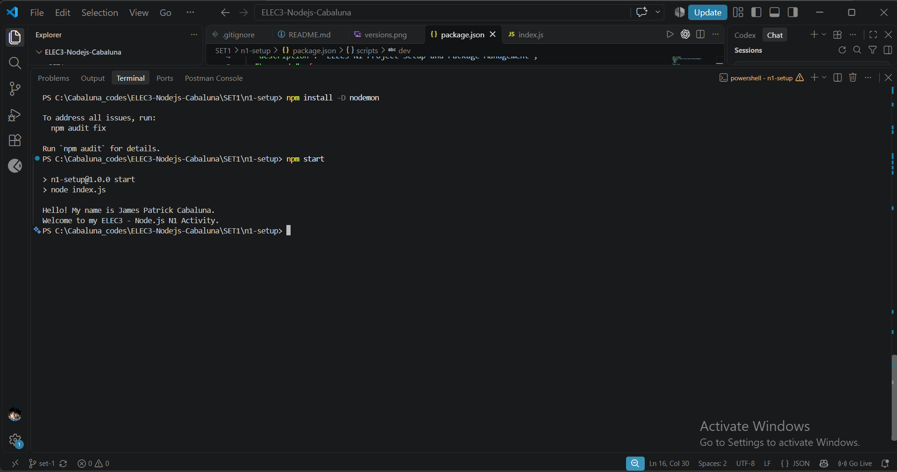
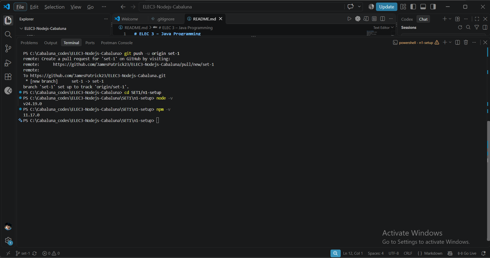
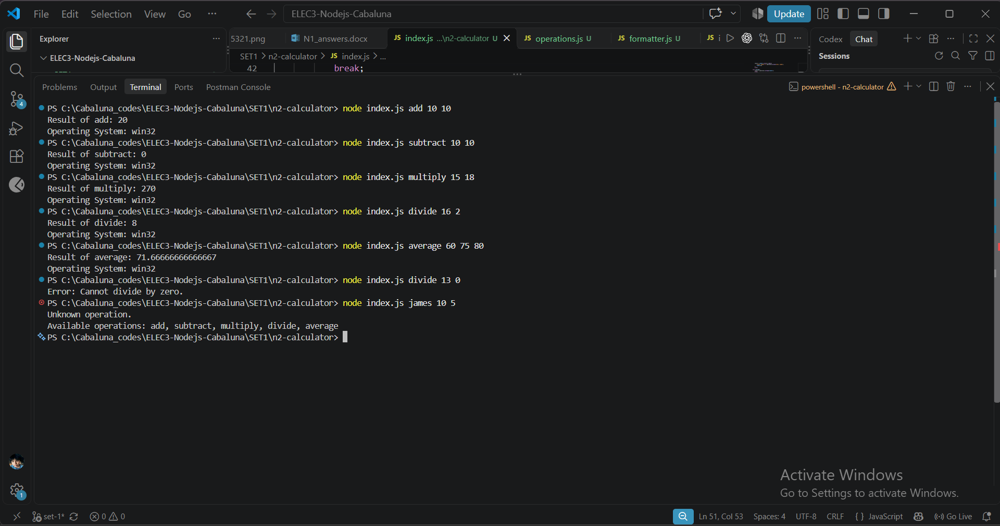
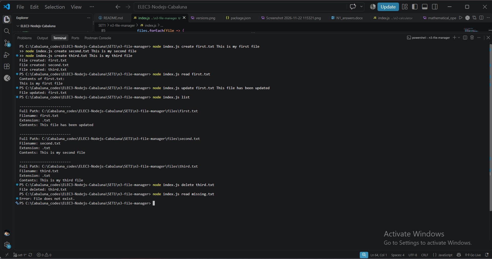

# ELEC 3 - Node.js Programming Activities

Name: James Patrick Cabaluna
Section: IV-BSIT-C
Course: ELEC 3 - Node.js Programming

## Set 1 Activities

| Activity | Description | Folder |
|---|---|---|
| N1 - Project Setup and Package Management | Initializes a Node.js project and manages npm packages. | [N1](set1/n1-setup/) |
| N2 - Modular Calculator | Performs calculations using custom modules and command-line arguments. | [N2](set1/n2-calculator/) |
| N3 - File Manager | Creates, reads, updates, deletes, and lists text files using fs and path. | [N3](set1/n3-file-manager/) |

## How to Run

### N1
cd set1/n1-setup
npm install
npm start

### N2
cd set1/n2-calculator
node index.js add 10 5

### N3
cd set1/n3-file-manager
node index.js list

## Screenshots

## Screenshots

### N1 - Project Setup and Package Management

### N2 - Modular Calculator

### N3 - File Manager

